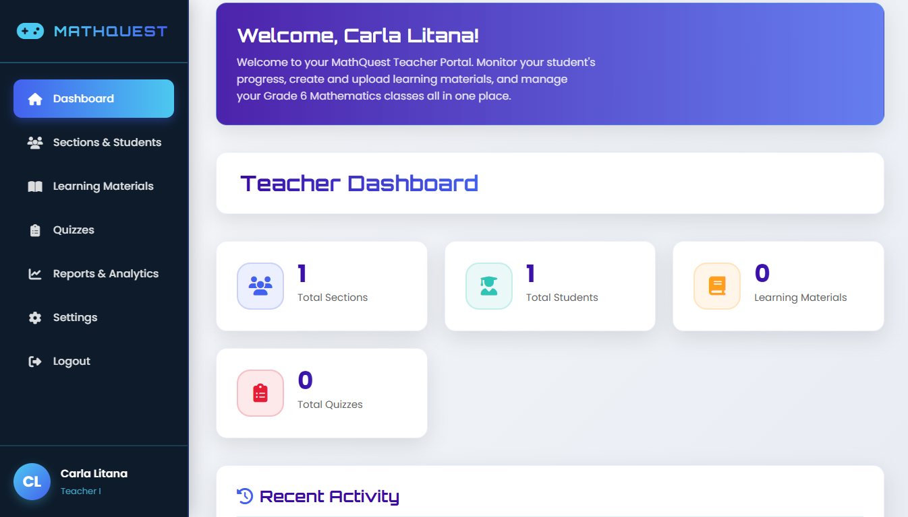
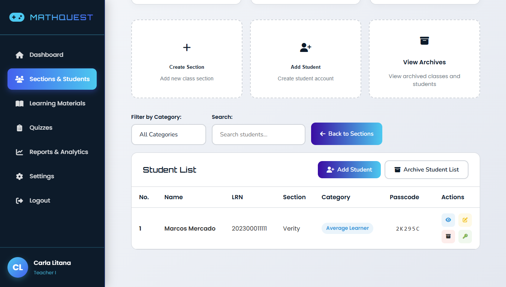
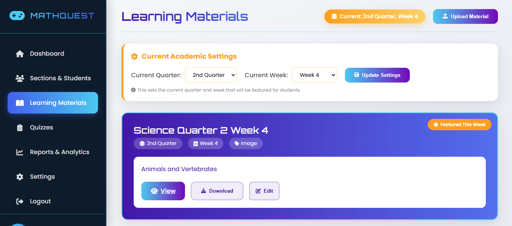
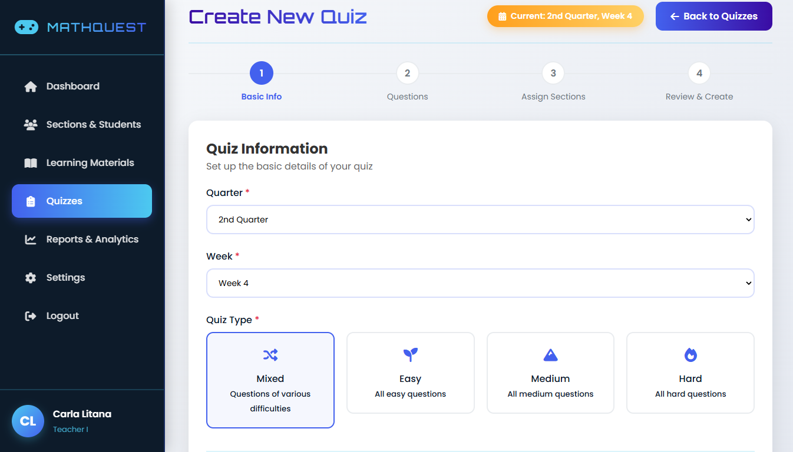
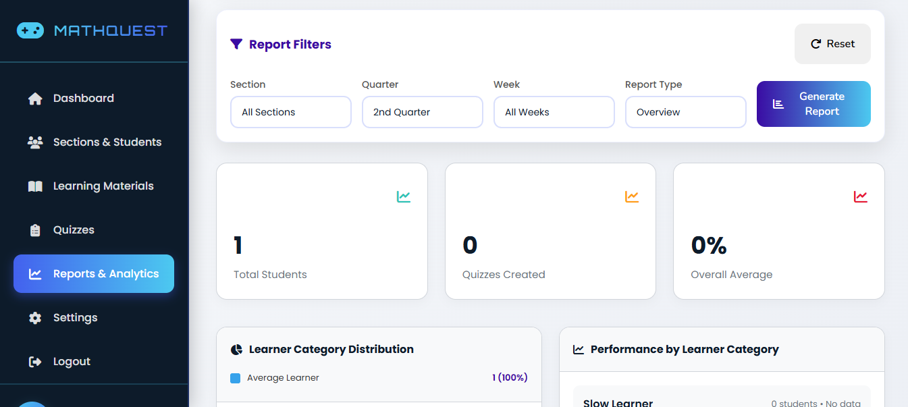

# MathQuest: Gamified Elementary Mathematics Learning Management System

MathQuest is a web-based learning management system and quiz application designed for elementary levels. This application was intended for Grade 6 teachers and students at Mapaniqui Elementary School. It was built using Laravel framework and then deployed on Hostinger, where I served as the backend and architecture lead.

Retrospectively, the conceptual level design of this project was the spiritual predecessor of our Capstone Project - an educational decision support system for senior high school level General Science. [You can view information about it here.](https://github.com/prionarie/scienteach-doc)



## 1. Project Status
- I am rebuilding this project to deepen my foundations in full-stack development by handling routing, ORM, authorization, and migrations end-to-end from scratch.
- I isolated the functional legacy code inside the `project/legacy/` folder to serve as a reference during the strangler fig process.
- I also took this opportunity to learn and apply Laravel Sail - Laravel's official Docker integration. With Docker containerization, the application becomes fully reproducible, reflecting professional development environments.
- **Key Goals:** Docker containerization via Laravel Sail, and configuration for cloud deployment (Azure/AWS/GCP)

## 2. Key Features

#### 2.1. Managing Students and Sections

- Teachers can create sections with an assigned school year.
- Inside a section, they can create students by adding their name and learner reference number (LRN).
- The system will generate a six-digit passcode that students will use to log in along with their LRN.
- The student list also displays the learning category of each student. Teachers can view each student's profile, which displays their learning progress summary across the school year.



#### 2.2. Learning Materials

- Teachers can upload learning materials that students can view. Creating a learning material must include its title, quarter, week, material type (module, presentation, video, image, or URL link), description, and uploaded file/link.
- They can set the current quarter and week, and the learning materials assigned for that period will be highlighted above the selection filter form.



#### 2.3. Creating Quizzes

- Teachers can create quizzes and assign them to students according to their learning categories.
- Teachers must select the quiz type, and each difficulty level will be assigned to students in the respective learning categories, i.e., "Easy Level" for "Slow Learners."
- Adding questions includes the question text, image (optional), difficulty level (for mixed quiz type), number of points, answer options from A to D, and an optional hint which will appear after a student submits an incorrect answer 3 times.
- Questions can be reordered with the up and down arrow keys, and the question number updates dynamically.
- After creating the questions, the teacher must assign the quiz to a section (one, multiple, or all) and assign its due date.
- Like in learning materials, quizzes assigned to the current quarter and week will be highlighted in the quiz catalog.



#### 2.4. Performance Reports

- Summary reports on student performance can be generated for every week or the entire quarter. This includes the selected sections' overall average score proficiency in quizzes, learner category distribution, average score proficiency per learning category, and a weekly performance graph.
- It also lists of the top 5 highest performing students and 5 lowest performing students, quiz completion rates for each section, difficulty analysis calculating the difficulty of quizzes (as opposed to what's set by the teacher), and, lastly, recommendations for each learning category.



## 3. Learning Categories and Points System

**3.1. Learner Ability Computation:** The system uses an Elo rating system to model each learner's ability. Each learner has an ability rating **Θ**, and each question has a difficulty rating **b** on the same scale:

| Difficulty | b (Elo) |
|------------|---------|
| Easy       | 900     |
| Medium     | 1025    |
| Hard       | 1175    |

Variables:
- **Θ** = learner ability rating (changes over time)
- **P** = expected probability of a correct answer (default prior: 0.5)
- **k** = learning rate / K-factor = 25 (standard range 20–30)
- **b** = difficulty rating of the question

**A. Expected probability of a correct answer according to learner ability**

```
P = 1 / (1 + 10^((b - Θ) / 400))
```

- If `Θ = b`, then `P = 0.5` (learner evenly matched to the question).
- Higher `Θ` (stronger learner) or lower `b` (easier question) → `P` rises toward 1.
- `400` is the standard Elo scale constant.

**B. Learner ability updates after each correct or wrong answer in a quiz**

```
Θ ← Θ + k(R - P),    k = 25
```

- `R = 1` if correct, `0` if incorrect.
- `(R − P)` is the prediction error: correct answers raise `Θ`, incorrect answers lower it.
- `k = 25` is the learning rate (K-factor), within the standard 20–30 range.

**3.2. Learner Categories:** After each update, `Θ` is compared against the cohort mean `μ` and standard deviation `σ` to classify the learner:

```
Slow Learner    = θ ≤ μ – 0.5σ
Average Learner = μ – 0.5σ < θ < μ + 0.5σ
Fast Learner    = θ ≥ μ + 0.5σ
```

**3.3. Points and Levels:** There are 50 levels in total, with 20 points required to advance to the next level:

```
33 (weeks in school year)
× 15 (average number of questions per quiz)
× 2 (quizzes per week)
= 990 points

990 ÷ 50 levels = 19.8 ≈ 20 points per level
```

## 4. Tech Stack

**Note:** This project is undergoing active rewrite. The original PHP application lives in the `public/legacy/` directory and is being ported to a modernized Laravel stack. Both legacy and modernized versions of the application can run during the transition period.

| Layer | Technology |
|---|---|
| Framework | Laravel |
| Backend | PHP |
| Database | MySQL |
| Frontend | Tailwind CSS |
| Containerization | Laravel Sail on Docker |

## 5. Project Structure

```
mathquest/
├── app/
├── bootstrap/
├── config/             
├── database/
├── public/     
│   ├── legacy/          # Original PHP code - for reference only, do not add features
├── resources/
├── routes/
├── storage/          
├── tests/          
├── docker-compose.yml   # app + mysql
└── vendor/ 
```

## 6. Installation

### 6.1. Prerequisites

- **Docker Desktop** (Windows/macOS) or **Docker Engine + Compose plugin** (Linux)
- **Git**
- **PHP** and **Composer 2**

### 6.2. Setup

```bash
git clone <repo-url> mathquest
cd mathquest

composer install
cp .env.example .env
./vendor/bin/sail artisan key:generate
./vendor/bin/sail up -d
./vendor/bin/sail artisan migrate
./vendor/bin/sail npm install
./vendor/bin/sail npm run dev
```

- Open http://localhost.
- **If you don't have local PHP** run Bootstrap dependencies in Docker first, then the rest is the same:

```bash
docker run --rm -u "$(id -u):$(id -g)" \
-v "$(pwd):/var/www/html" -w /var/www/html \
laravelsail/php84-composer:latest \
composer install --ignore-platform-reqs
```

- Verify DB connection:

```bash
./vendor/bin/sail artisan tinker
>>> DB::connection()->getPdo();
```

### 6.3. Common Errors

- **Port conflicts:** if 80, 3306, or 5173 are taken, set `APP_PORT=8080` and/or `FORWARD_DB_PORT=3307` in `.env`.
- **DB client (DBeaver):** `localhost:3306`, db `mathquest`, user `sail`, password `password`. Add `allowPublicKeyRetrieval=true` and `useSSL=false` in driver properties if it refuses.
